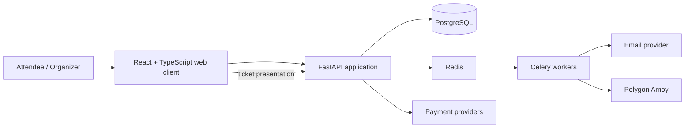

# Architecture overview

TokenChain Tickets is organized as a web application backed by an API, with asynchronous workers and optional blockchain integrations.

## Components

### Web client

The React and TypeScript single-page application provides the attendee and organizer interfaces. It is responsible for presenting events, account workflows, ticket information, and operational screens.

### API

The FastAPI application exposes the application interface and coordinates authentication, validation, business rules, persistence, and integrations. The codebase separates these concerns into modules such as routers, schemas, services, and data models.

### Persistence and background processing

PostgreSQL is the relational source for application data. Redis supports queued work and related application services; Celery workers handle work that should not block an API request, such as notifications or blockchain operations.

### Payments and blockchain

Payment and blockchain capabilities are integrations, not assumptions about a live deployment. Polygon Amoy is the development/test network referenced by the project. Test-network state is not production state, and any payment or contract workflow must be verified against its current implementation and configuration.

## Design boundaries

- The web client uses the API rather than connecting directly to the application database.
- The database remains necessary for application workflows and records even when a ticket has an on-chain representation.
- QR presentation and entry validation must be checked together with the corresponding authorization and ticket state; a QR image alone should not be treated as proof of validity.
- Blockchain transactions and payment-provider responses are external inputs. Their verification, failure behavior, and reconciliation need explicit review.
- Credentials and environment-specific values belong in local or managed secret configuration, never in source control.

This document describes the intended high-level shape, not a security certification or proof that every listed flow is complete.
